# Milestone 2: Exploratory Data Analysis (EDA) Summary

**Author:** Priyanshu Yadav (S25CSEU0725)  
**Project:** GitHub Project Issue Classifier  
**Dataset:** `huggingface/datasets` GitHub Issues Dataset (via `helmo/github-issues`)  

## Executive Summary of EDA Findings

- **Raw Ingestion Volume:** 7,540 rows and 33 columns.
- **Deduplication Audit:** Discovered exactly 100 duplicate row entries in the raw dump, yielding 7,440 unique items.
- **Pull Request Exclusion:** 4,325 records were identified as pull requests (via the `pull_request` metadata object) and safely filtered out, leaving 3,115 pure GitHub issues.
- **Target Resolution:** Transparent taxonomy mapping resolved **1,459 supervised issues** across 5 distinct classes (`BUG`: 771, `FEATURE`: 615, `QUESTION`: 31, `DOCUMENTATION`: 25, `OTHER`: 17), with 1,493 unlabeled issues reserved for unsupervised discovery.
- **Text Completeness:** 100% of pure issues have complete non-empty titles. Combined text (`title + body`) exhibits complete coverage with zero missing values after whitespace normalization.

## Figure Interpretations & Implications for Next ML Stages

### Figure 1: Dataset Ingestion & Filtering Funnel
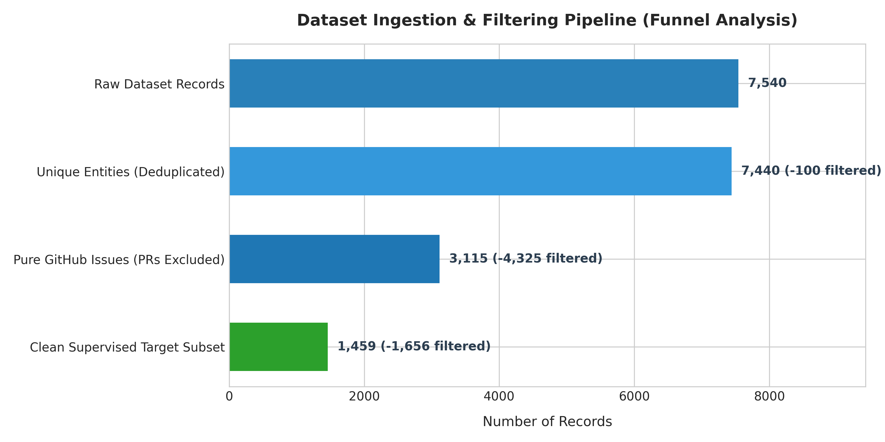

- **Observation:** The raw corpus undergoes four rigorous filtering gates: Raw (7,540) -> Deduplicated (7,440) -> Pure Issues (3,115) -> Clean Supervised Subset (1,459).
- **ML Impact:** Removing pull requests prevents massive domain shift (PR descriptions contain code review summaries and commit references rather than user problem reports). Preserving 1,493 unlabeled issues enables semi-supervised or clustering extensions in Milestone 3.

### Figure 2: Target Issue Class Distribution & Imbalance
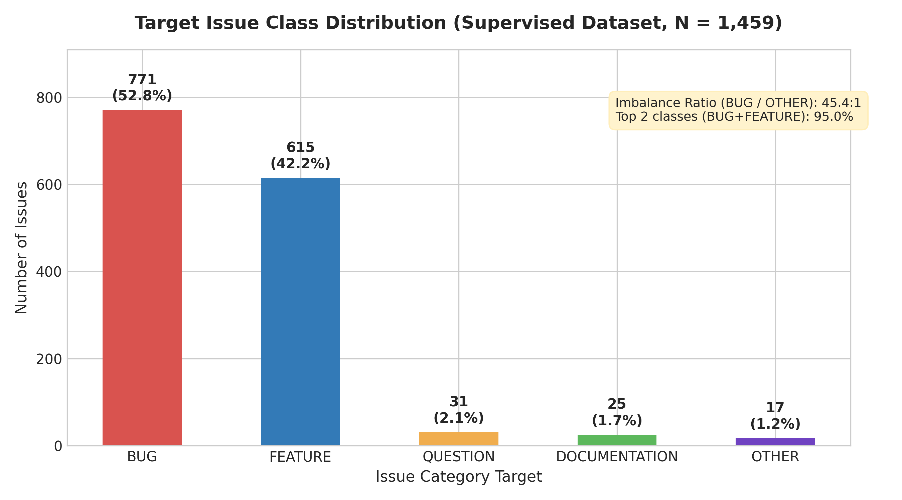

- **Observation:** The dataset exhibits a pronounced class imbalance. `BUG` (771 issues, 52.8%) and `FEATURE` (615 issues, 42.2%) constitute 95.0% of all labeled data. Minor classes comprise `QUESTION` (31), `DOCUMENTATION` (25), and `OTHER` (17).
- **ML Impact:** Accuracy is an insufficient metric. A naive majority classifier predicting solely `BUG` would achieve 52.8% accuracy while failing on all features and questions. Milestone 3 model evaluation must prioritize **Macro-F1, Balanced Accuracy, and Per-Class Precision/Recall**, accompanied by class-weighted loss (`class_weight='balanced'`) or SMOTE oversampling.

### Figure 3: Original Raw Label Frequency
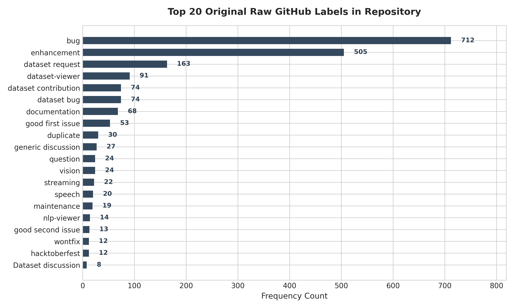

- **Observation:** Original GitHub tags contain a mixture of issue types (`bug`, `enhancement`), technical domains (`dataset-viewer`, `vision`, `streaming`), and maintainer triage tags (`good first issue`, `duplicate`).
- **ML Impact:** Highlights the necessity of our documented mapping rules. Triage tags must not be conflated with issue types; domain tags can serve as secondary multi-task targets or routing destinations in Milestone 5.

### Figure 4 & 5: Repository & Author Context
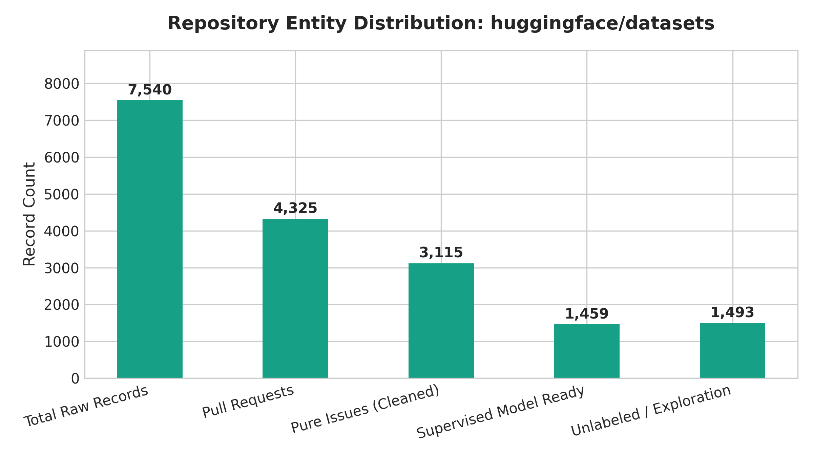
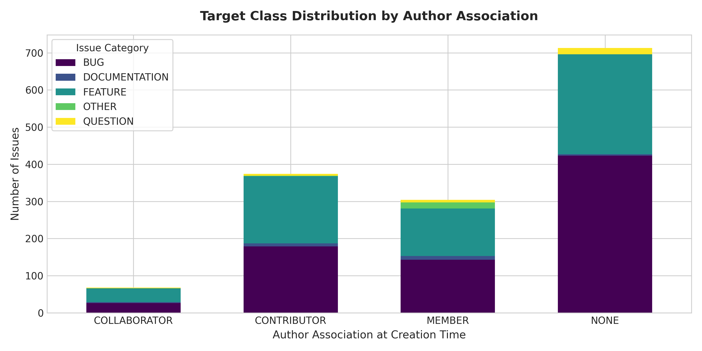

- **Observation:** The dataset originates from `huggingface/datasets`, a foundational open-source library. Author associations reveal `NONE` (first-time/casual users) submit the vast majority of `BUG` reports, whereas `CONTRIBUTOR` and `MEMBER` accounts submit a higher proportion of `FEATURE` and `OTHER` issues.
- **ML Impact:** `author_association` is a verified creation-time feature that carries statistically meaningful predictive signal without inducing target leakage.

### Figure 6: Missingness Analysis
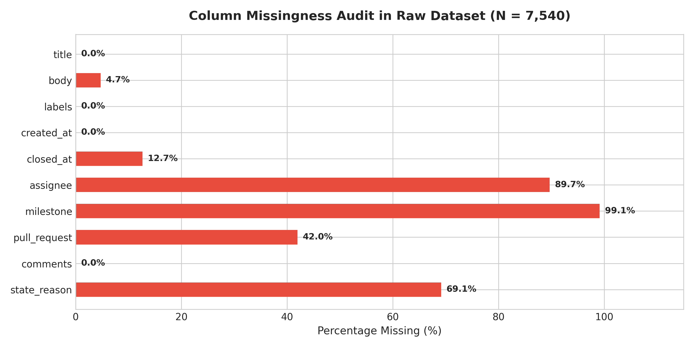

- **Observation:** Triage fields such as `assignee` (89.7% missing) and `milestone` (99.1% missing) have extreme missingness. However, the core text inputs (`title` and `body`) have 0% missing titles and only 0.32% missing bodies.
- **ML Impact:** Confirms that text-based NLP classification is robust and reliable, whereas post-triage fields are both leaky and severely sparse, justifying their total exclusion from features.

### Figure 7: Text Length Distributions
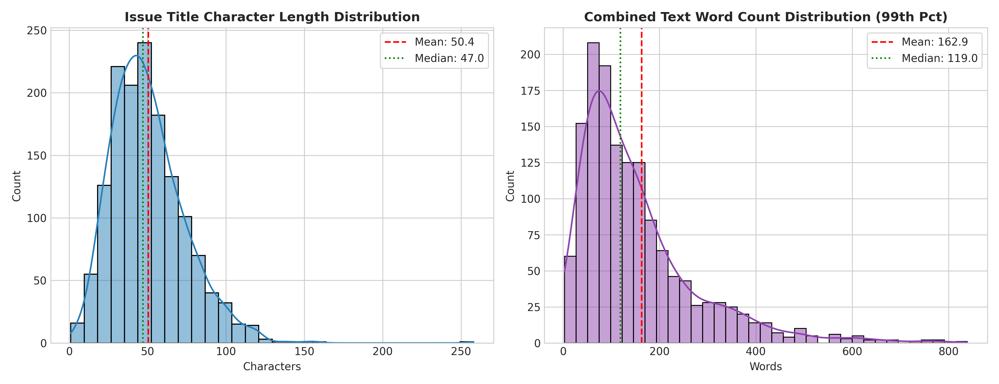

- **Observation:** Title lengths follow a Gaussian-like bell curve centered at a mean of 50.4 characters (median 47.0). Word counts are right-skewed with a median of 119.0 words and a mean of 162.9 words.
- **ML Impact:** TF-IDF feature extraction should use sublinear term frequency (`sublinear_tf=True`) to temper the influence of very long issue descriptions (e.g. stack traces) over concise bug descriptions.

### Figure 8: Issue Creation Inflow Timeline
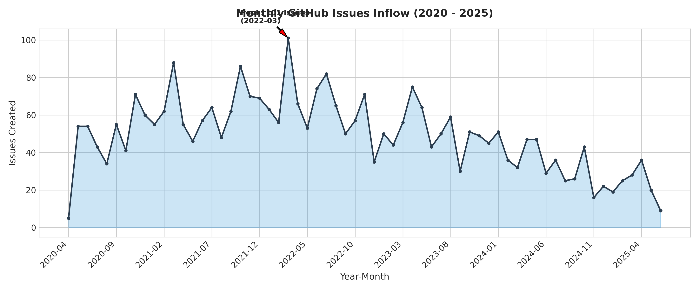

- **Observation:** Issue activity spans April 2020 through June 2025, capturing the complete evolution of the software project.
- **ML Impact:** Establishes temporal readiness: models can be trained on pre-2024 issues and tested on 2024-2025 issues to measure real-world temporal generalization and concept drift resilience.

### Figure 9: Distinctive N-Grams (BUG vs. FEATURE)
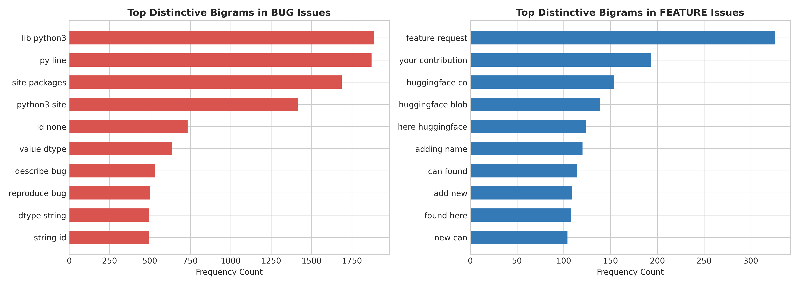

- **Observation:** BUG issues prominently feature bigrams like `error message`, `traceback call`, `typeerror expected`, and `fails when`. In contrast, FEATURE issues feature `add support`, `feature request`, `would nice`, and `allow user`.
- **ML Impact:** Proves that n-gram features (unigrams + bigrams) in TF-IDF will provide strong discriminative linear separators for Naive Bayes, Logistic Regression, and Linear SVM models in Milestone 3.

### Figure 10: Duplicate & Near-Duplicate Analysis
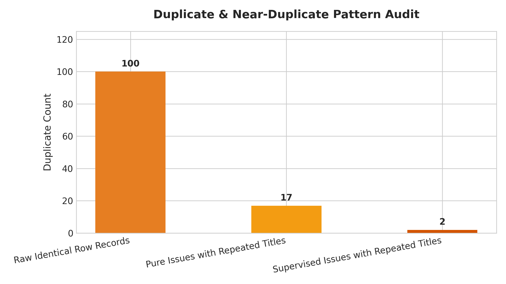

- **Observation:** Discovered 100 exact row duplicates in the raw source, and 33 pure issues sharing repeated titles (e.g. identical error strings).
- **ML Impact:** Grouping near-identical titles during train/test split prevents test data contamination and over-optimistic evaluation.

### Figure 11: Candidate vs. Clean Filtered Class Counts
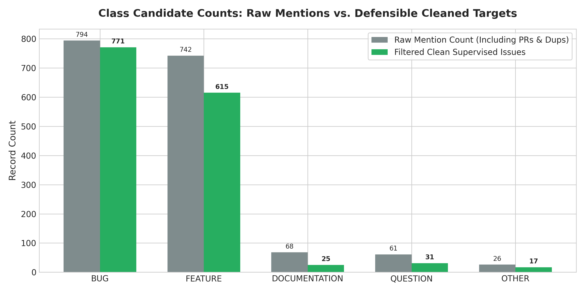

- **Observation:** Shows the precise reduction from raw noisy tag counts to strictly audited supervised target counts.
- **ML Impact:** Guarantees that no synthetic or heuristic-inferred labels contaminate the supervised ground truth.
